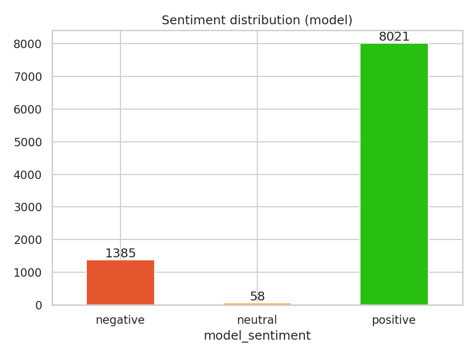
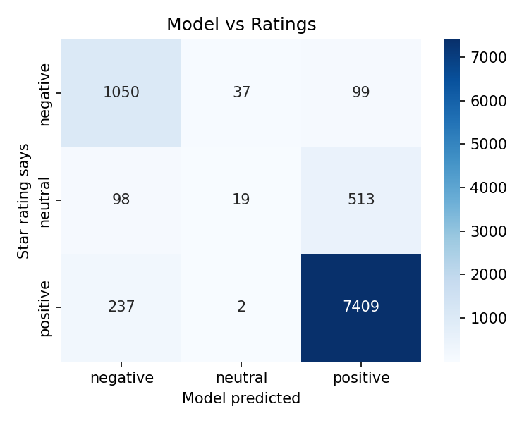
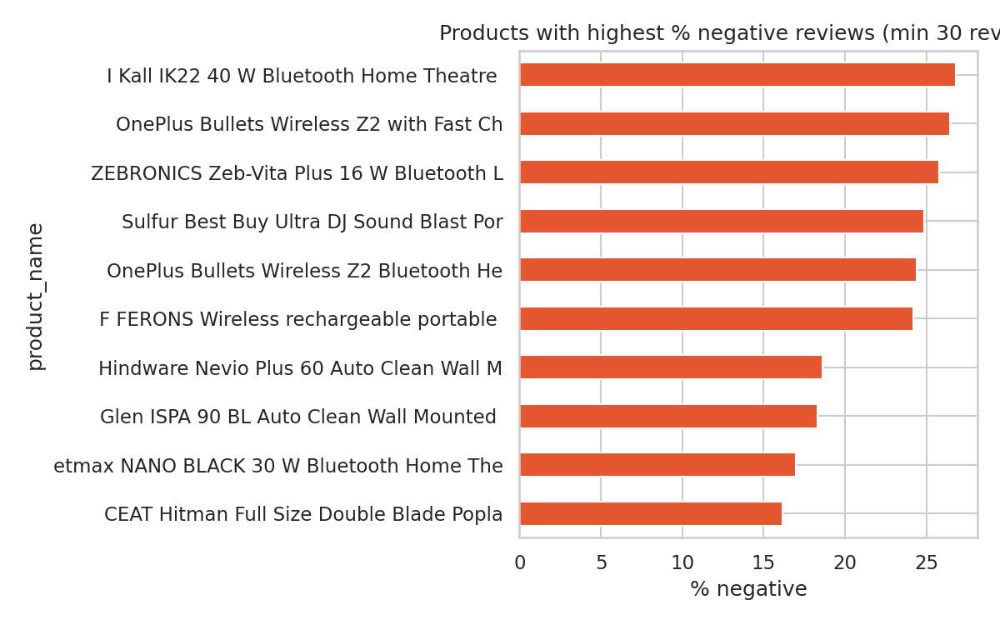
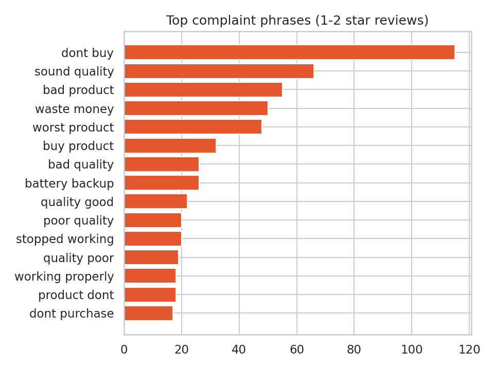

🛒 Customer Sentiment Analysis Dashboard

Analysis of Flipkart product reviews using a pretrained NLP model (DistilBERT), with an interactive dashboard to explore sentiment, problem products and common complain.

🔗 [Live Dashboard](https://my-sentiment-dashboard-26-30.streamlit.app/)

## Problem

An online shopping company receives thousands of product reviews, and reading them manually takes too long. This project answers:

- What share of customers are happy, neutral or unhappy?
- Which products get the highest share of negative reviews?
- What do customers complain about most?
- How reliable is an automatic sentiment model compared with star ratings?

## Dataset

- Flipkart product reviews (CSV) with product name, price, star rating, review title and review summary.
- 10,000 reviews were loaded and **9,464** were left after cleaning (duplicates and invalid rows removed).
- The average rating is **4.19 out of 5**.
- The dataset has **no date column**, so a trend over time could not be analysed.
  
## Method

1. **Cleaning:** I removed duplicate reviews, invalid ratings and empty text. I cleaned the product names and joined the review title and summary into one text.

2. **EDA:** I checked the number of reviews, the average rating, the rating distribution and the most-reviewed products.

3. **Sentiment analysis:** I used a pretrained Hugging Face model (`lxyuan/distilbert-base-multilingual-cased-sentiments-student`) to label every review as positive, neutral or negative. Each unique text was scored only once to save time.

4. **Validation:** I compared the model's labels with the star ratings (1-2 stars = negative, 3 stars = neutral, 4-5 stars = positive). I used accuracy, a classification report and a confusion matrix.

5. **Product analysis:** I calculated the percentage of negative reviews for each product. Only products with at least 30 reviews were included, so small samples do not give misleading results.

6. **Complaint analysis:** I found the most common two-word phrases in 1-2 star reviews, for example "not working" and "poor quality".

7. **Dashboard:** I built an interactive Streamlit dashboard with filters, summary cards and five tabs: Overview, Products, Complaints, Model quality and Insights.filters, KPIs and five tabs.


## Key findings

- **Sentiment split:** 84.8% positive, 14.6% negative and only 0.6% neutral.
- **Model vs ratings:** the model agrees with star ratings on **89.6%** of reviews.
- **Products with the highest share of negative reviews** (products with at least 30 reviews):
  - I Kall IK22 40 W Bluetooth Home Theatre: 26.8% negative (194 reviews)
  - OnePlus Bullets Wireless Z2: 26.5% negative (272 reviews)
  - ZEBRONICS Zeb-Vita Plus 16 W Bluetooth Speaker: 25.8% negative (372 reviews)
- **Most common phrases in 1-2 star reviews:** "dont buy" (115), "sound quality" (66), "bad product" (55), "waste money" (50) and "worst product" (48).
- **Pattern:** all three products with the most negative reviews are audio products (home theatre, wireless earphones and a speaker). "Sound quality" is also the most specific complaint phrase.
- **Recommendation:** the company should first check the sound quality of these three audio products, for example by reading their low-rated reviews and testing the products. Complaints like "dont buy" and "waste money" show strong dissatisfaction, but they don't say what the problem is.

  
## Charts

### Sentiment distribution


### Model vs ratings


### Negative reviews by product


### Top complaints



## Dashboard features

- Sidebar filters for product and star rating.
- Switch between AI-based sentiment and rating-based sentiment.
- KPI cards: total reviews, average rating, positive / neutral / negative share.
- Tabs: **Overview**, **Products**, **Complaints**, **Model quality**, **Insights**.

## Limitations

- **No dates** in the data, so satisfaction trends over time could not be analysed.
- **Star ratings are only a proxy** for true sentiment (for example, some 3★ reviews are actually positive).
- The model is **pretrained and not fine-tuned** on Flipkart reviews. Very short or mixed-language reviews (for example "fair") can be misclassified.
- Complaint phrases show what appears **together with low ratings**. They do not prove that a complaint causes customers to leave.
- The data is **heavily skewed towards positive reviews** (about 85%), so the 89.6% agreement is partly high because most reviews are easy positives.
- The model predicted a **neutral** label for only 0.6% of reviews, so it is weak at detecting neutral (3-star) opinions.
- The gap between the top three products (25.8% to 26.8%) is small, so they are similar in how often they get negative reviews.

  
## Tech stack

Python · Pandas · Hugging Face Transformers (DistilBERT) · Scikit-learn · Matplotlib · Seaborn · Plotly · Streamlit

## Project structure

```
├── analysis.py              # cleans data, runs model, validates, saves results + charts
├── app.py                   # Streamlit dashboard
├── reviews_scored.csv       # output of analysis.py, used by the dashboard
├── charts/                  # PNG charts from analysis.py
├── .streamlit/config.toml   # dashboard theme
├── requirements.txt         # dashboard dependencies
└── requirements-analysis.txt# analysis dependencies
```

## How to run

**1. Analysis** (use Google Colab with a GPU for speed)
```bash
pip install -r requirements-analysis.txt
python analysis.py
```
This creates `reviews_scored.csv` and the `charts/` folder.

**2. Dashboard**
```bash
pip install -r requirements.txt
streamlit run app.py
```
Open `http://localhost:8501`.

## Future improvements

- Compare DistilBERT with a simple TF-IDF + Logistic Regression baseline.
- Fine-tune the model on a labelled sample of these reviews.
- Add a time-trend view when review dates are available.

## Author

**Bhavana Tongare** · [LinkedIn](https://www.linkedin.com/in/https://www.linkedin.com/in/bhavana-tongare) · [GitHub](https://github.com/Bhavana-Tongare
